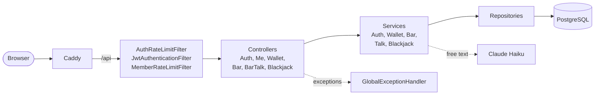
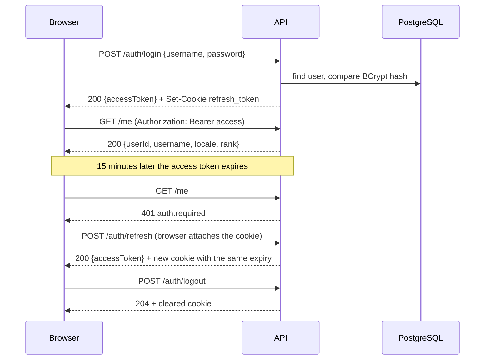

# IulianLounge: backend

[Español](README.md) | English


Iulian's is a 1920s speakeasy you visit in the browser. This repository is the API: accounts, sessions, the coin wallet, the bar with its bartender and a blackjack table. The client (Vue 3 and Three.js) lives in [iulianlounge-frontend](https://github.com/iulian640/iulianlounge-frontend).

- App: https://iulianlounge.com
- Presentation: https://iulianlounge.com/presentacion/
- This repo: https://github.com/iulian640/iulianlounge-backend

## What it does

- Bar: five drinks at fixed prices. Ordering one charges the wallet and the bartender answers according to your rank.
- Bartender: fixed lines per situation and rank. Free text goes to Claude Haiku (the official Anthropic Java SDK) only when `ANTHROPIC_API_KEY` is set. The LLM never moves money. Limits: a daily budget of 0.50 USD, 30 messages per member per day, 60 per IP per day, 10 per minute and 8 concurrent calls. Without a key, or on any failure, it answers with the fixed line.
- Ranks: derived from total spent at the bar. Recién llegado (0), Cliente (25), Habitual (100) and Socio (300). In the code they are `NADIE`, `HABITUAL`, `CONFIANZA` and `SOCIO`.
- House credit: with less balance than the cheapest drink, the house gives 50 coins once a day.
- Blackjack: one hand against the dealer, bets of 10, 20 or 50. The dealer stands on 17 and blackjack pays 3:2. Actions are idempotent and the deck never leaves the server.
- Wallet: new accounts get 100 coins. Every movement goes into an append-only ledger.

## Stack

Java 21 and Spring Boot 4. Spring Security with a hand-written JWT filter (jjwt), Spring Data JPA on PostgreSQL 17 in Docker, and Flyway migrations. Tests use JUnit 6, Mockito, MockMvc and a real PostgreSQL.

## Running locally

You need JDK 21 and Docker. Environment variables (read by `application.properties` and `docker-compose.yml`):

| Variable | Purpose | Default |
|---|---|---|
| `DB_PASSWORD` | PostgreSQL password | required |
| `JWT_SECRET` | HMAC key for the JWTs, base64, 32 bytes or more | required |
| `DB_PORT` | Local port of the container | `5432` |
| `DB_URL` | JDBC URL | `jdbc:postgresql://localhost:5432/iulianlounge` |
| `DB_USERNAME` | Database user | `postgres` |
| `ANTHROPIC_API_KEY` | Enables free text with the bartender | empty |

```bash
export DB_PASSWORD=pick_a_password
export JWT_SECRET=$(openssl rand -base64 32)
# If 5432 is taken: export DB_PORT=5433 and DB_URL=jdbc:postgresql://localhost:5433/iulianlounge

docker compose up -d        # PostgreSQL
./mvnw spring-boot:run      # API on localhost:8080
```

`curl localhost:8080/actuator/health` should return `{"status":"UP"}`. If `JWT_SECRET` is not base64 or decodes to fewer than 32 bytes, the app refuses to start, on purpose.

The frontend dev server proxies `/api` to `localhost:8080`.

Without `ANTHROPIC_API_KEY` the bartender never touches the network and always answers with the fixed line.

## Tests

```bash
./mvnw verify
```

Last run: 636 tests, 0 failures. JaCoCo reports close to 99 % instruction coverage, and the build fails if line coverage drops below 80 % (`pom.xml`). There are four kinds:

- Unit tests for services and domain, including the blackjack engine, which is plain Java.
- MockMvc slices for controllers, filters and errors.
- Integration tests against a real PostgreSQL (the one from `docker compose`, through `DB_URL`).
- Concurrency tests for the ledger and the bartender memory.

Integration tests need the database up.

## API

Base path `/api/v1`, 15 endpoints. Responses are plain JSON, no envelope. "JWT" means an `Authorization: Bearer <accessToken>` header.

| Method | Path | Auth | Purpose |
|---|---|---|---|
| POST | `/auth/register` | public | Creates the account and a wallet with 100 coins |
| POST | `/auth/login` | public | Returns the access token and sets the `refresh_token` cookie |
| POST | `/auth/refresh` | public (cookie) | Issues a new access token and rotates the cookie |
| POST | `/auth/logout` | public | Clears the refresh cookie |
| GET | `/me` | JWT | User, locale and rank |
| GET | `/wallet` | JWT | Balance |
| GET | `/wallet/transactions` | JWT | Paginated movements (`page`, `size`, max 50) |
| GET | `/bar` | JWT | Menu, balance, rank and whether house credit is available |
| POST | `/bar/orders` | JWT | Orders a drink (`Idempotency-Key` header) |
| POST | `/bar/house-credit` | JWT | Claims the daily 50-coin house credit |
| POST | `/bar/talk` | JWT | Free text to the bartender |
| GET | `/blackjack` | JWT | Hand in progress (or `null`), balance and possible bets |
| POST | `/blackjack/hands` | JWT | Deals a hand (`Idempotency-Key` and a bet) |
| POST | `/blackjack/hands/{id}/hit` | JWT | Draws a card |
| POST | `/blackjack/hands/{id}/stand` | JWT | Stands, then the dealer plays |

`GET /actuator/health` is also public and is the only Actuator endpoint exposed.

Errors follow RFC 7807 (`ProblemDetail`) with a stable `code`. The frontend translates the `code`; `detail` is English and only for debugging:

```json
{
  "status": 400,
  "code": "validation.failed",
  "detail": "Request validation failed",
  "errors": { "email": "validation.email", "password": "validation.size" }
}
```

The full list of codes is in [`ErrorCode`](src/main/java/com/iulianlounge/backend/exception/ErrorCode.java).

## Security

- Spring Security with no server session and a custom `OncePerRequestFilter` for the JWT (jjwt). The access token is short-lived and the frontend keeps it in memory.
- The refresh token travels in an `HttpOnly; Secure; SameSite=Strict` cookie. Logout clears it in the browser; the server does not revoke it, so a stolen refresh token stays valid until it expires.
- Passwords use BCrypt. If the user does not exist, login compares against a dummy hash so response time does not give it away.
- `AuthRateLimitFilter` limits login and register per IP. `MemberRateLimitFilter` limits orders, bets and `talk` per member.
- Behind the proxy, the client IP is resolved with `server.forward-headers-strategy=native`. Caddy strips forwarding headers the client could spoof.
- Errors use `ProblemDetail` with no stack traces or internal messages, and Caddy caps the request body size.
- The database backs the domain with `CHECK` constraints: `balance >= 0`, signed amounts by movement type, bets of 10, 20 or 50.

## How it's built

### Layers

Every request goes through the filters and then down the layers: the controller speaks HTTP, the service holds the rules and the repository talks to the database. No controller touches a repository.



### A session, start to finish



### Data

PostgreSQL 17 in Docker and Flyway migrations V1 to V7:

| Migration | What it does |
|---|---|
| `V1__create_users_table.sql` | Users table |
| `V2__make_email_unique_case_insensitive.sql` | Case-insensitive unique email |
| `V3__constrain_user_role_and_locale.sql` | `CHECK` on role and locale |
| `V4__create_wallet_and_ledger.sql` | Wallet and ledger |
| `V5__allow_bar_movement_types.sql` | `BAR_ORDER` and `HOUSE_CREDIT` types |
| `V6__index_and_sign_bar_movements.sql` | Index by wallet and type, and the sign of `BAR_ORDER` |
| `V7__create_blackjack_hand_and_ledger_types.sql` | Hands table and blackjack types |

The ledger is append-only and the balance is materialized in `wallet`. Amounts are `long` in Java and `bigint` in the database. Indexes, class diagrams and the sequences for ordering a drink and dealing a hand are in [docs/diagramas.md](docs/diagramas.md) (Spanish).

```mermaid
erDiagram
    users ||--o| wallet : "wallet.user_id"
    wallet ||--o{ token_transaction : "token_transaction.wallet_id"
    users ||--o{ blackjack_hand : "blackjack_hand.user_id"

    users {
        uuid id PK
        varchar username UK "50, [A-Za-z0-9_.-]"
        text email UK "unique, case-insensitive"
        varchar password_hash "BCrypt"
        text role "CHECK: USER, ADMIN"
        text locale "CHECK: es, en"
        timestamptz created_at
        timestamptz last_seen_at
    }

    wallet {
        uuid id PK
        uuid user_id FK,UK "ON DELETE CASCADE"
        bigint balance "CHECK >= 0"
        bigint version "optimistic lock"
        timestamptz created_at
    }

    token_transaction {
        uuid id PK
        uuid wallet_id FK "ON DELETE RESTRICT"
        bigint amount "signed, BAR_ORDER and BLACKJACK_BET always < 0"
        text type "WELCOME_BONUS, BAR_ORDER, HOUSE_CREDIT, BLACKJACK_BET, BLACKJACK_PAYOUT"
        bigint balance_after "CHECK >= 0"
        text idempotency_key "unique per wallet, max 64"
        timestamptz created_at
    }

    blackjack_hand {
        uuid id PK
        uuid user_id FK "ON DELETE CASCADE, one PLAYER_TURN per member"
        uuid idempotency_key "unique per member"
        bigint bet "CHECK: 10, 20, 50"
        text status "PLAYER_TURN, FINISHED, VOID"
        text outcome "BLACKJACK, WIN, PUSH, LOSE"
        bigint payout "tied to the outcome"
        text deck "server only"
        text player_cards
        text dealer_cards "server only until the hand ends"
        bigint version "optimistic lock"
        timestamptz created_at
        timestamptz finished_at
        timestamptz settled_at
    }
```



## Deployment

Production runs at https://iulianlounge.com on an Oracle Cloud ARM instance in Madrid with Docker Compose: PostgreSQL, the backend and Caddy, which serves the frontend build, proxies `/api` and gets HTTPS from Let's Encrypt. A database dump is taken before migrating. Steps are in [deploy/README.md](deploy/README.md) (Spanish).

## Documentation

The ER, class and sequence diagrams, in Mermaid, are in [docs/diagramas.md](docs/diagramas.md) (Spanish).

## Process

Work was tracked in Jira (project IUL): 50 tasks in 15 epics. Sprint 1 Auth and wallet (3 to 17 July), the summer on the 3D lounge, Sprint 8 Full auth (16 to 22 September), Sprint 9 Wallet, HUD and mobile (25 September to 1 October), Sprint 10 Bar and blackjack (7 to 9 October) and Sprint 11 Mobile and delivery (10 to 13 October). Commits follow conventional commits with the Jira key.

Frontend repository: https://github.com/iulian640/iulianlounge-frontend
