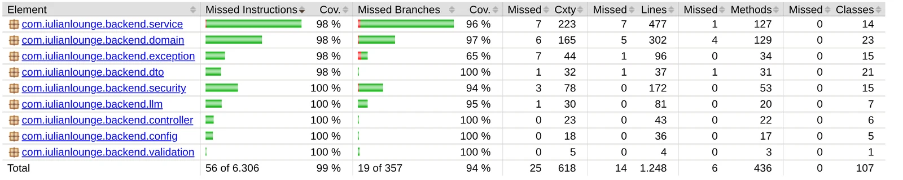
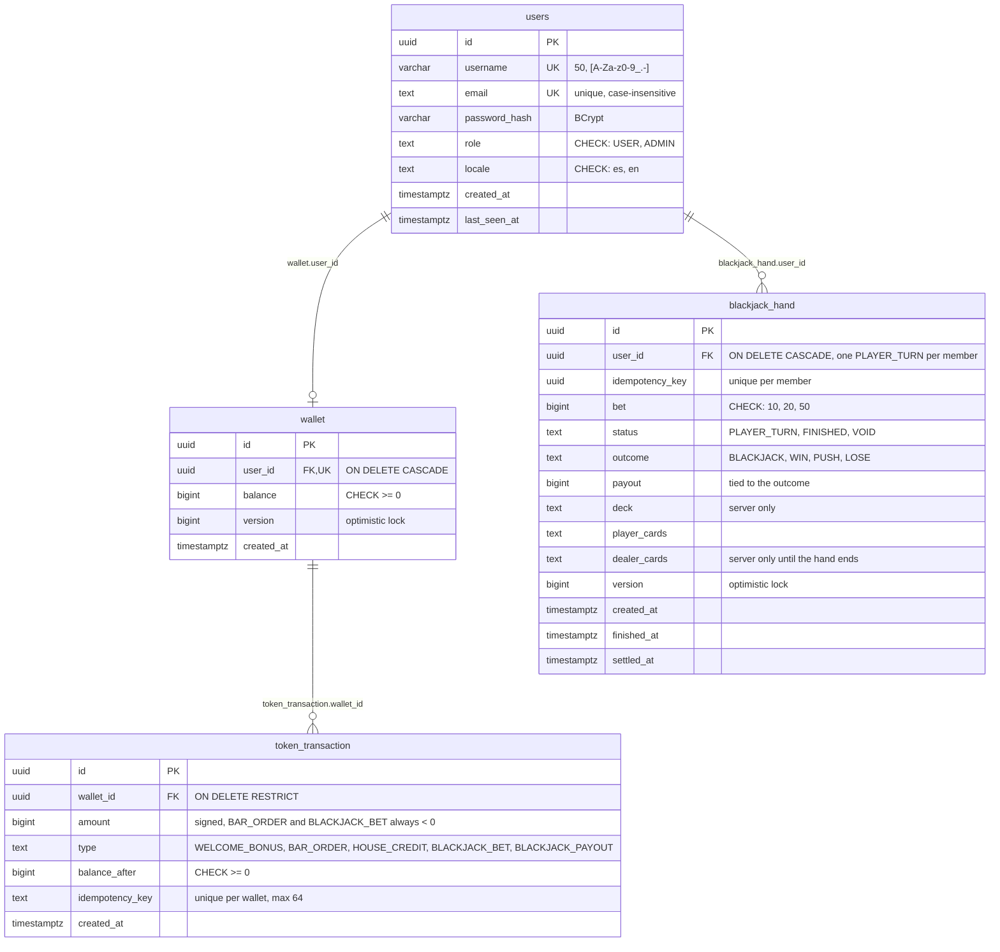

# IulianLounge · Backend

REST API for IulianLounge, a 1920s speakeasy you visit in the browser: accounts, a coin wallet, a bar with a bartender and blackjack.


[App](https://iulianlounge.com) · [Presentation](https://iulianlounge.com/presentacion/) · [Frontend](https://github.com/iulian640/iulianlounge-frontend) · [Penpot](https://design.penpot.app/#/view?file-id=52a5041f-08a1-80f1-8008-c797da3e231e&page-id=72937cd6-6e9c-4b4e-991d-639a5ecf7b58&section=interactions&index=0&share-id=d0c6b4b3-247d-4110-95db-19385af7feb2)

[Español](README.md) | English

## Contents

- [What it does](#what-it-does)
- [Tech stack](#tech-stack)
- [Requirements](#requirements)
- [Installation](#installation)
- [Environment variables](#environment-variables)
- [API](#api)
- [Tests](#tests)
- [Database and diagrams](#database-and-diagrams)
- [Security](#security)
- [Deployment](#deployment)
- [Project management](#project-management)
- [Author](#author)

## What it does

- Sign-up and login. Every new account gets a wallet with 100 welcome coins.
- The bar: five cocktails from 5 to 40 coins. An order is charged to your balance and adds to your total spend, which decides your rank. If you hit zero, the house gives you 50 free coins once a day.
- Blackjack against the house: bets of 10, 20 or 50. The server shuffles, deals and pays out; the deck never leaves the server.
- The bartender: answers with fixed lines depending on the situation and your rank. Free text goes to Claude Haiku, but only if the server has `ANTHROPIC_API_KEY`. It is switched off in production. Without a key, or if the model fails, it answers with the fixed line. The model never moves coins.

Ranks come from total spend at the bar: 0, 25, 100 and 300 coins. In the code they are `NADIE`, `HABITUAL`, `CONFIANZA` and `SOCIO`; in the interface, "Recién llegado", "Cliente", "Habitual" and "Socio".

## Tech stack

| Technology | Version | Used for |
|---|---|---|
| Java | 21 | Language |
| Spring Boot | 4.1.0 | Framework (web MVC, validation, Actuator) |
| Spring Security | the one in Spring Boot 4.1.0 | Authentication and filters |
| Spring Data JPA | the one in Spring Boot 4.1.0 | Data access |
| PostgreSQL | 17 | Database |
| Flyway | the one in Spring Boot 4.1.0 | Migrations (V1 to V7) |
| jjwt | 0.13.0 | Signing and reading JWTs |
| anthropic-java | 2.68.0 | Official Anthropic SDK, for the bartender |
| JaCoCo | 0.8.13 | Coverage |
| JUnit, Mockito, MockMvc | the ones in Spring Boot 4.1.0 | Tests |
| Maven Wrapper | included | Build |
| Docker Compose | | Local PostgreSQL and deployment |
| Caddy | | Reverse proxy with HTTPS (production) |

## Requirements

- JDK 21
- Docker (with Docker Compose)
- Git

You don't need Maven: the repository ships the wrapper (`mvnw` and `mvnw.cmd`).

## Installation

1. Clone the repository and enter the folder:

   ```bash
   git clone https://github.com/iulian640/iulianlounge-backend.git
   cd iulianlounge-backend
   ```

2. Set the environment variables. `DB_PASSWORD` and `JWT_SECRET` are required; the app won't start without them.

   Linux and macOS:

   ```bash
   export DB_PASSWORD=pick_a_password
   export JWT_SECRET=$(openssl rand -base64 32)
   ```

   Windows (PowerShell):

   ```powershell
   $env:DB_PASSWORD = "pick_a_password"
   $bytes = New-Object byte[] 32
   (New-Object System.Security.Cryptography.RNGCryptoServiceProvider).GetBytes($bytes)
   $env:JWT_SECRET = [Convert]::ToBase64String($bytes)
   ```

   If port 5432 is taken, use another one: `DB_PORT=5433` and `DB_URL=jdbc:postgresql://localhost:5433/iulianlounge`.

3. Start PostgreSQL:

   ```bash
   docker compose up -d
   ```

4. Start the API (Flyway creates the tables on startup):

   ```bash
   ./mvnw spring-boot:run
   ```

   On Windows: `.\mvnw.cmd spring-boot:run`.

5. Check that it responds:

   ```bash
   curl http://localhost:8080/actuator/health
   ```

   It must return `{"status":"UP"}`. If `JWT_SECRET` is not base64 or is shorter than 32 bytes, the app refuses to start. That is intended.

Start the frontend afterwards, from [its repository](https://github.com/iulian640/iulianlounge-frontend). Its dev server proxies `/api` to `localhost:8080`.

## Environment variables

| Variable | Required | Purpose |
|---|---|---|
| `DB_PASSWORD` | Yes | PostgreSQL password. Used by the app and `docker-compose.yml` |
| `JWT_SECRET` | Yes | HMAC key for the JWTs, base64, 32 bytes or more |
| `DB_URL` | No | JDBC URL. Defaults to `jdbc:postgresql://localhost:5432/iulianlounge` |
| `DB_USERNAME` | No | Database user. Defaults to `postgres` |
| `DB_PORT` | No | Local port of the PostgreSQL container. Defaults to `5432` |
| `ANTHROPIC_API_KEY` | No | Enables the bartender's free text with Claude Haiku. Empty by default |

## API

Base path `/api/v1`, 15 endpoints. Responses are plain JSON, no envelope. Endpoints marked JWT need the header `Authorization: Bearer <accessToken>`.

| Resource | Method | Path | JWT | What it does |
|---|---|---|---|---|
| Auth | POST | `/auth/register` | No | Creates the account and its wallet with 100 coins |
| Auth | POST | `/auth/login` | No | Returns the access token and sets the `refresh_token` cookie |
| Auth | POST | `/auth/refresh` | No (cookie) | Issues a new access token and rotates the cookie |
| Auth | POST | `/auth/logout` | No | Clears the refresh cookie |
| Profile | GET | `/me` | Yes | User, language and rank |
| Wallet | GET | `/wallet` | Yes | Balance |
| Wallet | GET | `/wallet/transactions` | Yes | Paginated movements (`page`, `size`, max 50) |
| Bar | GET | `/bar` | Yes | Menu, balance, rank and whether house credit is available |
| Bar | POST | `/bar/orders` | Yes | Orders a cocktail (`Idempotency-Key` header) |
| Bar | POST | `/bar/house-credit` | Yes | Claims the daily 50 coins from the house |
| Bar | POST | `/bar/talk` | Yes | Free text to the bartender |
| Blackjack | GET | `/blackjack` | Yes | Hand in progress (or `null`), balance and available bets |
| Blackjack | POST | `/blackjack/hands` | Yes | Deals a hand (`Idempotency-Key` and bet) |
| Blackjack | POST | `/blackjack/hands/{id}/hit` | Yes | Draws a card |
| Blackjack | POST | `/blackjack/hands/{id}/stand` | Yes | Stands; the house plays |

`GET /actuator/health` is public and is the only Actuator endpoint exposed.

Sign-up and login example:

```bash
curl -X POST http://localhost:8080/api/v1/auth/register \
  -H "Content-Type: application/json" \
  -d '{"username":"iulian","email":"iulian@example.com","password":"a-long-password","locale":"en"}'

curl -X POST http://localhost:8080/api/v1/auth/login \
  -H "Content-Type: application/json" \
  -c cookies.txt \
  -d '{"username":"iulian","password":"a-long-password"}'
```

Login returns `{"accessToken":"..."}` and stores the refresh cookie in `cookies.txt`. With the token you can call the rest:

```bash
curl http://localhost:8080/api/v1/wallet -H "Authorization: Bearer <accessToken>"
```

Errors follow RFC 7807 (`ProblemDetail`) with a stable `code` that the frontend translates. The list is in [`ErrorCode`](src/main/java/com/iulianlounge/backend/exception/ErrorCode.java).

## Tests

```bash
./mvnw verify
```

It needs the Docker database running (`docker compose up -d`) and `DB_PASSWORD` and `JWT_SECRET` set, because the integration tests use a real PostgreSQL.

There are 627 tests in 55 classes:

| Type | Classes | Built with |
|---|---|---|
| Unit | 34 (9 with Mockito) | JUnit and Mockito |
| Controllers and filters | 10 | MockMvc with `@WebMvcTest` |
| Repositories | 3 | `@DataJpaTest` against PostgreSQL |
| Integration | 8 | `@SpringBootTest` |

Line coverage is 98.9% with JaCoCo, and the build fails below 80% (configured in `pom.xml`).



## Database and diagrams

The balance is a movement ledger: every change is a row in `token_transaction` and `wallet.balance` stores the result. Coins are integers (`bigint`) and a `CHECK` prevents a negative balance. Flyway migrations run from V1 to V7.



The class and sequence diagrams (ordering a cocktail, dealing and paying out a hand) are in [docs/diagramas.md](docs/diagramas.md), written in Spanish.

## Security

- Passwords hashed with BCrypt. If the user doesn't exist, login compares against a fake hash so response time doesn't give it away.
- 15-minute access JWT, with Spring Security and a custom filter (`OncePerRequestFilter`) that validates it. No server-side session.
- The refresh token travels in a cookie that is `HttpOnly`, `Secure` and `SameSite=Strict`.
- Limit of 20 attempts per minute on login and sign-up.
- Orders and bets are idempotent: repeating the same `Idempotency-Key` never charges twice.
- Errors don't expose stack traces or internal details.

## Deployment

Production runs at https://iulianlounge.com, on an ARM instance of Oracle Cloud in Madrid. Docker Compose runs PostgreSQL, the backend and Caddy, which serves the frontend, forwards `/api` and gets HTTPS from Let's Encrypt. The steps are in [deploy/README.md](deploy/README.md), written in Spanish.

## Project management

The work was tracked in Jira (project IUL): 50 tasks in 15 epics, 43 done. One branch per task and commits that carry the task key (`IUL-xx`). The design is in [Penpot](https://design.penpot.app/#/view?file-id=52a5041f-08a1-80f1-8008-c797da3e231e&page-id=72937cd6-6e9c-4b4e-991d-639a5ecf7b58&section=interactions&index=0&share-id=d0c6b4b3-247d-4110-95db-19385af7feb2).

| Sprint | Goal | Dates |
|---|---|---|
| 1 | Auth and wallet | 3 to 17 July |
| 8 | Full auth | 16 to 22 September |
| 9 | Wallet, HUD and mobile | 25 September to 1 October |
| 10 | Bar and blackjack | 7 to 9 October |
| 11 | Mobile and delivery | 10 to 13 October |

Between July and September the frontend's 3D lounge was built, outside any sprint. That is why the board jumps from sprint 1 to 8.

## Author

Iulian Timofei · [github.com/iulian640](https://github.com/iulian640)
