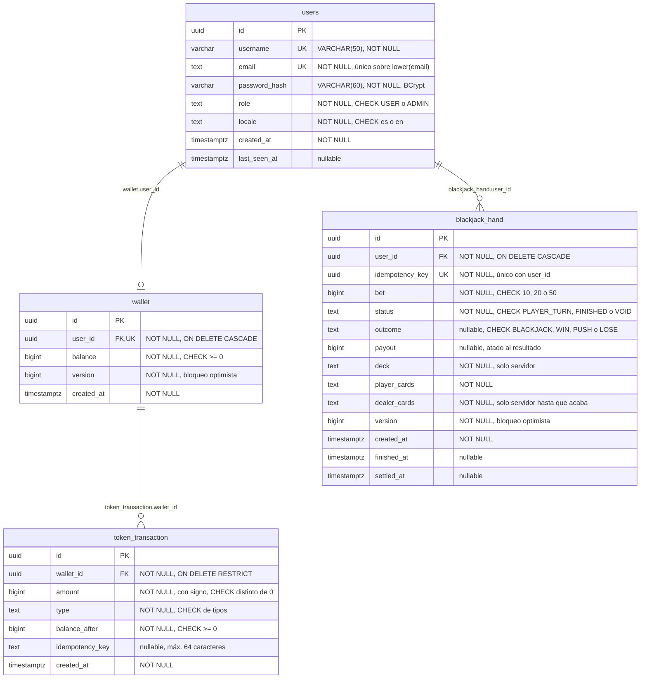

# IulianLounge · Backend

API REST de IulianLounge, un speakeasy de los años 20 que se visita desde el navegador: cuentas, cartera de monedas, barra con barman y blackjack.


[App](https://iulianlounge.com) · [Presentación](https://iulianlounge.com/presentacion/) · [Frontend](https://github.com/iulian640/iulianlounge-frontend) · [Figma](https://www.figma.com/design/ns6uohIpSej1vuw90QWlpX)

Español | [English](README.en.md)

## Índice

- [Qué hace](#qué-hace)
- [Tecnologías](#tecnologías)
- [Requisitos](#requisitos)
- [Instalación](#instalación)
- [Variables de entorno](#variables-de-entorno)
- [API](#api)
- [Tests](#tests)
- [Base de datos y diagramas](#base-de-datos-y-diagramas)
- [Seguridad](#seguridad)
- [Despliegue](#despliegue)
- [Gestión del proyecto](#gestión-del-proyecto)
- [Problemas conocidos y mejoras futuras](#problemas-conocidos-y-mejoras-futuras)
- [Autor](#autor)

## Qué hace

- Registro y login. Cada cuenta nueva recibe una cartera con 100 monedas de bienvenida.
- La barra: cinco cócteles de 5 a 40 monedas. El pedido cobra del saldo y suma al gasto total, que decide tu rango. Si te quedas a cero, la casa te da 50 monedas gratis una vez al día.
- Blackjack contra la casa: apuestas de 10, 20 o 50. El servidor baraja, reparte y paga; el mazo no sale nunca del servidor.
- El barman: responde con frases fijas según la situación y tu rango. El texto libre va a Claude Haiku, pero solo si el servidor tiene `ANTHROPIC_API_KEY`. Está apagado en producción. Sin clave, o si el modelo falla, contesta con la frase fija. El modelo nunca mueve monedas.

Los rangos salen del gasto total en la barra: 0, 25, 100 y 300 monedas. En el código se llaman `NADIE`, `HABITUAL`, `CONFIANZA` y `SOCIO`; en la interfaz, «Recién llegado», «Cliente», «Habitual» y «Socio».

## Tecnologías

| Tecnología | Versión | Para qué |
|---|---|---|
| Java | 21 | Lenguaje |
| Spring Boot | 4.1.0 | Framework (web MVC, validación, Actuator) |
| Spring Security | la de Spring Boot 4.1.0 | Autenticación y filtros |
| Spring Data JPA | la de Spring Boot 4.1.0 | Acceso a datos |
| PostgreSQL | 17 | Base de datos |
| Flyway | la de Spring Boot 4.1.0 | Migraciones (V1 a V7) |
| jjwt | 0.13.0 | Firma y lectura de los JWT |
| anthropic-java | 2.68.0 | SDK oficial de Anthropic, para el barman |
| JaCoCo | 0.8.13 | Cobertura |
| JUnit, Mockito, MockMvc | las de Spring Boot 4.1.0 | Tests |
| Maven Wrapper | incluido | Build |
| Docker Compose | | PostgreSQL local y despliegue |
| Caddy | | Proxy inverso con HTTPS (producción) |

## Requisitos

- JDK 21
- Docker (con Docker Compose)
- Git

Maven no hace falta: el repositorio trae el wrapper (`mvnw` y `mvnw.cmd`).

## Instalación

1. Clona el repositorio y entra en la carpeta:

   ```bash
   git clone https://github.com/iulian640/iulianlounge-backend.git
   cd iulianlounge-backend
   ```

2. Define las variables de entorno. `DB_PASSWORD` y `JWT_SECRET` son obligatorias; la app no arranca sin ellas.

   Linux y macOS:

   ```bash
   export DB_PASSWORD=elige_una_contraseña
   export JWT_SECRET=$(openssl rand -base64 32)
   ```

   Windows (PowerShell):

   ```powershell
   $env:DB_PASSWORD = "elige_una_contraseña"
   $bytes = New-Object byte[] 32
   (New-Object System.Security.Cryptography.RNGCryptoServiceProvider).GetBytes($bytes)
   $env:JWT_SECRET = [Convert]::ToBase64String($bytes)
   ```

   Si el puerto 5432 está ocupado, usa otro: `DB_PORT=5433` y `DB_URL=jdbc:postgresql://localhost:5433/iulianlounge`.

3. Levanta PostgreSQL:

   ```bash
   docker compose up -d
   ```

4. Arranca la API (Flyway crea las tablas al arrancar):

   ```bash
   ./mvnw spring-boot:run
   ```

   En Windows: `.\mvnw.cmd spring-boot:run`.

5. Comprueba que responde:

   ```bash
   curl http://localhost:8080/actuator/health
   ```

   Debe devolver `{"status":"UP"}`. Si `JWT_SECRET` no es base64 o tiene menos de 32 bytes, la app no arranca. Es a propósito.

El frontend se arranca después, desde [su repositorio](https://github.com/iulian640/iulianlounge-frontend). Su servidor de desarrollo reenvía `/api` a `localhost:8080`.

## Variables de entorno

| Variable | Obligatoria | Para qué |
|---|---|---|
| `DB_PASSWORD` | Sí | Contraseña de PostgreSQL. La usan la app y `docker-compose.yml` |
| `JWT_SECRET` | Sí | Clave HMAC de los JWT, en base64 y de 32 bytes o más |
| `DB_URL` | No | URL JDBC. Por defecto `jdbc:postgresql://localhost:5432/iulianlounge` |
| `DB_USERNAME` | No | Usuario de la base de datos. Por defecto `postgres` |
| `DB_PORT` | No | Puerto local del contenedor de PostgreSQL. Por defecto `5432` |
| `ANTHROPIC_API_KEY` | No | Activa el texto libre del barman con Claude Haiku. Vacía por defecto |

## API

Ruta base `/api/v1`, 15 endpoints. Las respuestas son JSON plano, sin envoltorio. Los endpoints con JWT piden la cabecera `Authorization: Bearer <accessToken>`.

| Recurso | Método | Ruta | JWT | Qué hace |
|---|---|---|---|---|
| Auth | POST | `/auth/register` | No | Crea la cuenta y su cartera con 100 monedas |
| Auth | POST | `/auth/login` | No | Devuelve el access token y pone la cookie `refresh_token` |
| Auth | POST | `/auth/refresh` | No (cookie) | Emite un access token nuevo y rota la cookie |
| Auth | POST | `/auth/logout` | No | Borra la cookie del refresh |
| Perfil | GET | `/me` | Sí | Usuario, idioma y rango |
| Cartera | GET | `/wallet` | Sí | Saldo |
| Cartera | GET | `/wallet/transactions` | Sí | Movimientos paginados (`page`, `size`, máximo 50) |
| Barra | GET | `/bar` | Sí | Carta, saldo, rango y si hay crédito de la casa disponible |
| Barra | POST | `/bar/orders` | Sí | Pide un cóctel (cabecera `Idempotency-Key`) |
| Barra | POST | `/bar/house-credit` | Sí | Pide las 50 monedas diarias de la casa |
| Barra | POST | `/bar/talk` | Sí | Texto libre al barman |
| Blackjack | GET | `/blackjack` | Sí | Mano en curso (o `null`), saldo y apuestas posibles |
| Blackjack | POST | `/blackjack/hands` | Sí | Reparte una mano (`Idempotency-Key` y apuesta) |
| Blackjack | POST | `/blackjack/hands/{id}/hit` | Sí | Pide carta |
| Blackjack | POST | `/blackjack/hands/{id}/stand` | Sí | Se planta y juega la casa |

`GET /actuator/health` es público y es lo único de Actuator que se expone.

Ejemplo de registro y login:

```bash
curl -X POST http://localhost:8080/api/v1/auth/register \
  -H "Content-Type: application/json" \
  -d '{"username":"iulian","email":"iulian@example.com","password":"una-clave-larga","locale":"es"}'

curl -X POST http://localhost:8080/api/v1/auth/login \
  -H "Content-Type: application/json" \
  -c cookies.txt \
  -d '{"username":"iulian","password":"una-clave-larga"}'
```

El login devuelve `{"accessToken":"..."}` y guarda la cookie del refresh en `cookies.txt`. Con el token ya puedes llamar al resto:

```bash
curl http://localhost:8080/api/v1/wallet -H "Authorization: Bearer <accessToken>"
```

Los errores siguen RFC 7807 (`ProblemDetail`) con un `code` estable que el frontend traduce. La lista está en [`ErrorCode`](src/main/java/com/iulianlounge/backend/exception/ErrorCode.java).

## Tests

```bash
./mvnw verify
```

Necesita la base de datos de Docker levantada (`docker compose up -d`) y las variables `DB_PASSWORD` y `JWT_SECRET` definidas, porque los tests de integración usan un PostgreSQL real.

Hay 627 tests en 55 clases:

| Tipo | Clases | Con qué |
|---|---|---|
| Unitarios | 34 (9 con Mockito) | JUnit y Mockito |
| Controllers y filtros | 10 | MockMvc con `@WebMvcTest` |
| Repositorios | 3 | `@DataJpaTest` contra PostgreSQL |
| Integración | 8 | `@SpringBootTest` |

La cobertura de líneas es del 98,9 % con JaCoCo, y el build falla si baja del 80 % (configurado en `pom.xml`).


## Base de datos y diagramas

El saldo es un libro de movimientos: cada cambio es una fila de `token_transaction` y `wallet.balance` guarda el resultado. Las monedas son enteros (`bigint`) y un `CHECK` impide el saldo negativo. Las migraciones de Flyway van de V1 a V7.



Los diagramas de clases y de secuencia (pedir un cóctel, repartir y pagar una mano) están en [docs/diagramas.md](docs/diagramas.md).

## Seguridad

- Contraseñas con BCrypt. Si el usuario no existe, el login compara contra un hash falso para que el tiempo de respuesta no lo delate.
- JWT de acceso de 15 minutos, con Spring Security y un filtro propio (`OncePerRequestFilter`) que lo valida. No hay sesión de servidor.
- El refresh token viaja en una cookie `HttpOnly`, `Secure` y `SameSite=Strict`.
- Límite de 20 intentos por minuto en login y registro.
- Los pedidos y las apuestas son idempotentes: repetir la misma `Idempotency-Key` no cobra dos veces.
- Los errores no enseñan stack traces ni detalles internos.

## Despliegue

Producción está en https://iulianlounge.com, en una instancia ARM de Oracle Cloud en Madrid. Docker Compose levanta PostgreSQL, el backend y Caddy, que sirve el frontend, reenvía `/api` y saca el HTTPS con Let's Encrypt. Los pasos están en [deploy/README.md](deploy/README.md).

## Gestión del proyecto

El trabajo se llevó en Jira (proyecto IUL): 50 tareas en 15 épicas, 43 terminadas. Una rama por tarea y commits con la clave de la tarea (`IUL-xx`). El diseño está en [Figma](https://www.figma.com/design/ns6uohIpSej1vuw90QWlpX).

| Sprint | Objetivo | Fechas |
|---|---|---|
| 1 | Auth y cartera | 3 a 17 de julio |
| 8 | Auth completa | 16 a 22 de septiembre |
| 9 | Cartera, HUD y móvil | 25 de septiembre a 1 de octubre |
| 10 | Barra y blackjack | 7 a 9 de octubre |
| 11 | Móvil y entrega | 10 a 13 de octubre |

Entre julio y septiembre se hizo el lounge 3D del frontend, fuera de sprints. Por eso el tablero salta del sprint 1 al 8.

## Problemas conocidos y mejoras futuras

- El refresh token no se revoca en el servidor. El logout borra la cookie del navegador, pero un refresh robado vale hasta que caduque.
- El barman con IA está apagado en producción.
- No hay panel de administración ni Swagger.
- Los nombres de usuario distinguen mayúsculas y minúsculas.

## Autor

Iulian Timofei · [github.com/iulian640](https://github.com/iulian640)
