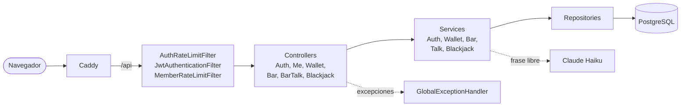
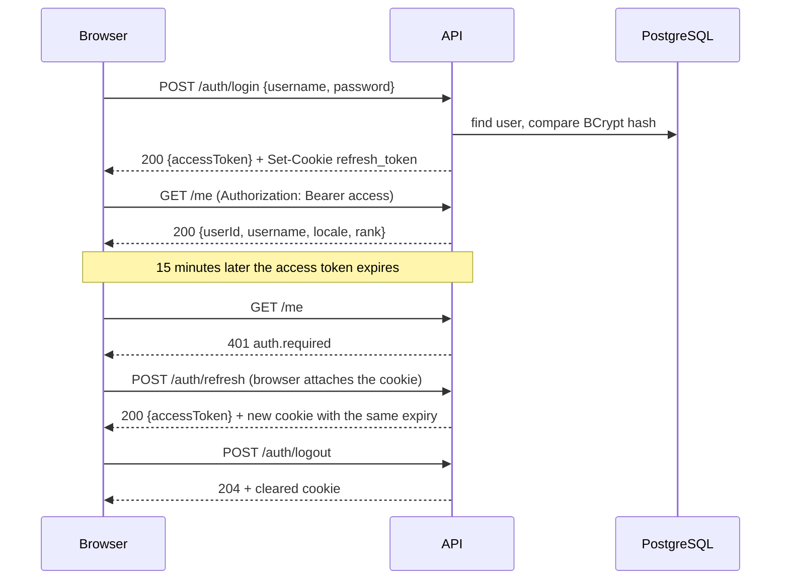
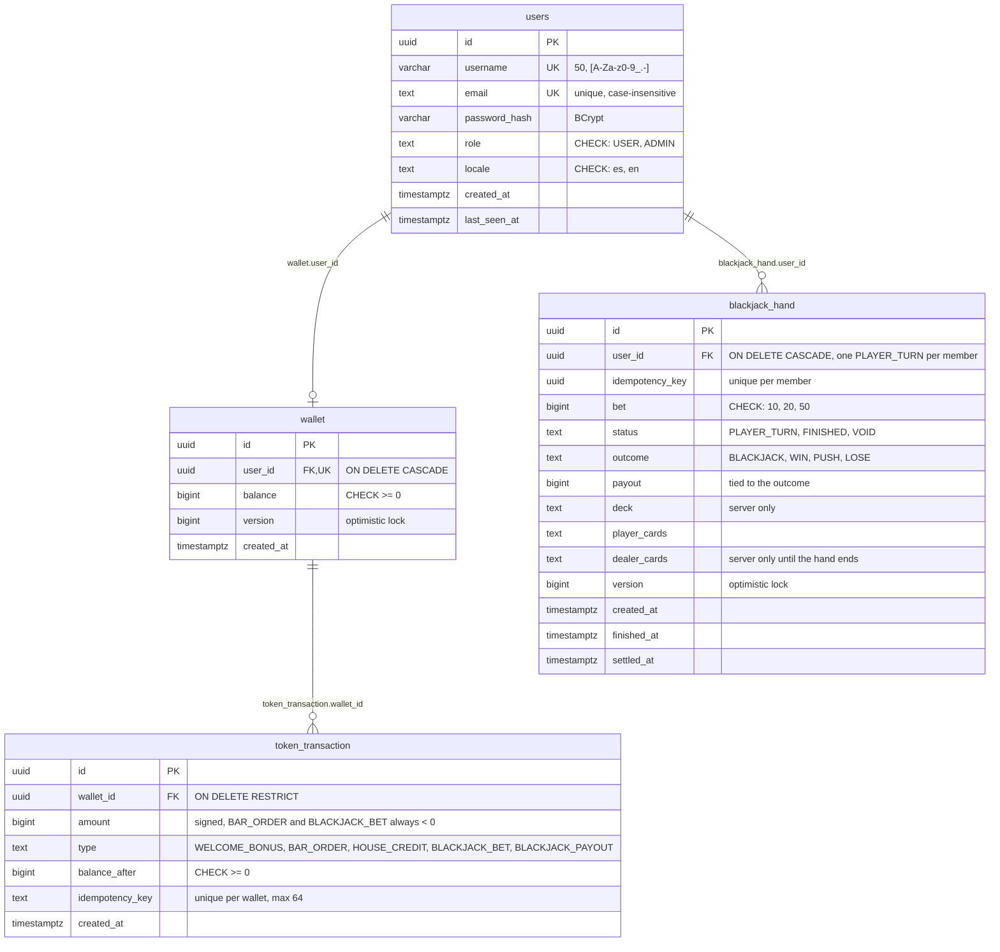

# IulianLounge: backend

Español | [English](README.en.md)


Iulian's es un speakeasy de los años 20 que se visita desde el navegador. Este repositorio es la API: cuentas, sesiones, la cartera de monedas, la barra con su barman y una mesa de blackjack. El cliente (Vue 3 y Three.js) está en [iulianlounge-frontend](https://github.com/iulian640/iulianlounge-frontend).

- App: https://iulianlounge.com
- Presentación: https://iulianlounge.com/presentacion/
- Este repo: https://github.com/iulian640/iulianlounge-backend

## Qué hace

- Barra: cinco copas con precio fijo. Pedir una copa cobra de la cartera y el barman contesta según tu rango.
- Barman: tiene frases fijas por situación y rango. El texto libre va a Claude Haiku (SDK oficial de Anthropic para Java) solo si hay `ANTHROPIC_API_KEY`. El LLM nunca mueve dinero. Límites: presupuesto diario de 0,50 USD, 30 mensajes por socio y día, 60 por IP y día, 10 por minuto y 8 llamadas a la vez. Sin clave, o ante cualquier fallo, contesta con la frase fija.
- Rangos: salen del gasto total en la barra. Recién llegado (0), Cliente (25), Habitual (100) y Socio (300). En el código son `NADIE`, `HABITUAL`, `CONFIANZA` y `SOCIO`.
- Fiado de la casa: con menos saldo que la copa más barata, la casa regala 50 monedas una vez al día.
- Blackjack: una mano contra el crupier, apuestas de 10, 20 o 50. El crupier se planta en 17 y el blackjack paga 3:2. Las acciones son idempotentes y el mazo no sale del servidor.
- Cartera: las cuentas nuevas reciben 100 monedas. Cada movimiento queda en un ledger que solo crece.

## Stack

Java 21 y Spring Boot 4. Spring Security con un filtro JWT escrito a mano (jjwt), Spring Data JPA sobre PostgreSQL 17 en Docker y migraciones con Flyway. Pruebas con JUnit 5, Mockito, MockMvc y un PostgreSQL real.

## Arrancar en local

Hace falta JDK 21 y Docker. Variables de entorno (las lee `application.properties` y `docker-compose.yml`):

| Variable | Para qué | Por defecto |
|---|---|---|
| `DB_PASSWORD` | Contraseña de PostgreSQL | obligatoria |
| `JWT_SECRET` | Clave HMAC de los JWT, en base64 y de 32 bytes o más | obligatoria |
| `DB_PORT` | Puerto local del contenedor | `5432` |
| `DB_URL` | URL JDBC | `jdbc:postgresql://localhost:5432/iulianlounge` |
| `DB_USERNAME` | Usuario de la BD | `postgres` |
| `ANTHROPIC_API_KEY` | Activa el texto libre del barman | vacía |

```bash
export DB_PASSWORD=elige_una_contraseña
export JWT_SECRET=$(openssl rand -base64 32)
# Si el 5432 está ocupado: export DB_PORT=5433 y DB_URL=jdbc:postgresql://localhost:5433/iulianlounge

docker compose up -d        # PostgreSQL
./mvnw spring-boot:run      # API en localhost:8080
```

`curl localhost:8080/actuator/health` debería devolver `{"status":"UP"}`. Si `JWT_SECRET` no es base64 o es más corta de 32 bytes, la app no arranca, a propósito.

El servidor de desarrollo del frontend hace proxy de `/api` a `localhost:8080`.

Sin `ANTHROPIC_API_KEY` el barman no llama a la red y responde siempre con la frase fija. El razonamiento está en la enmienda del 2026-10-07 de [ADR-05](docs/adr/ADR-05-barman-llm-function-calling-lista-blanca.md).

## Tests

```bash
./mvnw verify
```

La última ejecución: 636 tests, 0 fallos. JaCoCo mide cerca del 99 % de instrucciones, y el build falla si la cobertura de líneas baja del 80 % (`pom.xml`). Hay cuatro tipos:

- Unitarios de servicios y dominio, incluido el motor de blackjack, que es Java puro.
- Slices con MockMvc para controllers, filtros y errores.
- Integración contra un PostgreSQL real (el del `docker compose`, vía `DB_URL`).
- Concurrencia sobre el ledger y sobre la memoria del barman.

Los tests de integración necesitan la base de datos arriba.

## API

Ruta base `/api/v1`, 15 endpoints. Las respuestas son JSON plano, sin envoltorio. "JWT" significa cabecera `Authorization: Bearer <accessToken>`.

| Método | Ruta | Auth | Para qué |
|---|---|---|---|
| POST | `/auth/register` | pública | Crea la cuenta y la cartera con 100 monedas |
| POST | `/auth/login` | pública | Devuelve el access token y pone la cookie `refresh_token` |
| POST | `/auth/refresh` | pública (cookie) | Emite un access token nuevo y rota la cookie |
| POST | `/auth/logout` | pública | Borra la cookie del refresh |
| GET | `/me` | JWT | Usuario, idioma y rango |
| GET | `/wallet` | JWT | Saldo |
| GET | `/wallet/transactions` | JWT | Movimientos paginados (`page`, `size`, máximo 50) |
| GET | `/bar` | JWT | Carta, saldo, rango y si hay fiado disponible |
| POST | `/bar/orders` | JWT | Pide una copa (cabecera `Idempotency-Key`) |
| POST | `/bar/house-credit` | JWT | Pide el fiado diario de 50 monedas |
| POST | `/bar/talk` | JWT | Texto libre al barman |
| GET | `/blackjack` | JWT | Mano en curso (o `null`), saldo y apuestas posibles |
| POST | `/blackjack/hands` | JWT | Reparte una mano (`Idempotency-Key` y apuesta) |
| POST | `/blackjack/hands/{id}/hit` | JWT | Pide carta |
| POST | `/blackjack/hands/{id}/stand` | JWT | Se planta y juega el crupier |

Además, `GET /actuator/health` es público y es lo único de Actuator que se expone.

Los errores siguen RFC 7807 (`ProblemDetail`) con un `code` estable. El frontend traduce el `code`; `detail` está en inglés y es solo para depurar ([ADR-06](docs/adr/ADR-06-i18n-claves-backend-textos-frontend.md)):

```json
{
  "status": 400,
  "code": "validation.failed",
  "detail": "Request validation failed",
  "errors": { "email": "validation.email", "password": "validation.size" }
}
```

La lista completa de códigos está en [`ErrorCode`](src/main/java/com/iulianlounge/backend/exception/ErrorCode.java).

## Seguridad

- Spring Security sin sesión de servidor y un `OncePerRequestFilter` propio para el JWT (jjwt). El access token dura poco y vive en memoria del frontend.
- El refresh token viaja en una cookie `HttpOnly; Secure; SameSite=Strict`. El logout la borra del navegador; el servidor no la revoca, así que un refresh robado sigue valiendo hasta que caduca ([ADR-08](docs/adr/ADR-08-jwt-stateless-con-refresh-token.md)).
- Contraseñas con BCrypt. Si el usuario no existe, el login compara contra un hash falso para que el tiempo de respuesta no lo delate.
- `AuthRateLimitFilter` limita login y registro por IP. `MemberRateLimitFilter` limita pedidos, apuestas y `talk` por socio.
- Detrás del proxy, la IP del cliente se resuelve con `server.forward-headers-strategy=native`. Caddy descarta las cabeceras de reenvío que pueda falsear el cliente.
- Errores en `ProblemDetail` sin stack traces ni mensajes internos, y límite de tamaño del body en Caddy.
- La base de datos defiende el dominio con `CHECK`: `balance >= 0`, importes con signo según el tipo de movimiento, apuestas de 10, 20 o 50.

## Cómo está montado

### Capas

Cada petición pasa por los filtros y baja por las capas: el controller habla HTTP, el service tiene las reglas y el repository habla con la base de datos. Ningún controller toca un repository.



### Una sesión, de principio a fin



### Datos

PostgreSQL 17 en Docker y migraciones de Flyway, de V1 a V7:

| Migración | Qué hace |
|---|---|
| `V1__create_users_table.sql` | Tabla de usuarios |
| `V2__make_email_unique_case_insensitive.sql` | Email único sin distinguir mayúsculas |
| `V3__constrain_user_role_and_locale.sql` | `CHECK` de rol e idioma |
| `V4__create_wallet_and_ledger.sql` | Cartera y ledger |
| `V5__allow_bar_movement_types.sql` | Tipos `BAR_ORDER` y `HOUSE_CREDIT` |
| `V6__index_and_sign_bar_movements.sql` | Índice por cartera y tipo, y signo de `BAR_ORDER` |
| `V7__create_blackjack_hand_and_ledger_types.sql` | Tabla de manos y tipos de blackjack |

El ledger solo crece y el saldo está materializado en `wallet` ([ADR-04](docs/adr/ADR-04-ledger-append-only-saldo-materializado.md)). Los importes son `long` en Java y `bigint` en la base de datos ([ADR-09](docs/adr/ADR-09-fichas-enteros-long-prohibido-double.md)). Los índices, los diagramas de clases y las secuencias de pedir una copa y repartir una mano están en [docs/diagramas.md](docs/diagramas.md).



## Despliegue

Producción vive en https://iulianlounge.com, en una instancia ARM de Oracle Cloud en Madrid con Docker Compose: PostgreSQL, el backend y Caddy, que sirve el build del frontend, proxea `/api` y saca el HTTPS con Let's Encrypt. Antes de migrar se hace un volcado de la base de datos. Los pasos están en [deploy/README.md](deploy/README.md).

## Documentación

| Documento | Contenido |
|---|---|
| [CONCEPT.md](CONCEPT.md) | Concepto de producto |
| [docs/architecture.md](docs/architecture.md) | Arquitectura técnica |
| [docs/diagramas.md](docs/diagramas.md) | Diagramas ER y de clases en Mermaid |
| [docs/ficcion.md](docs/ficcion.md) | La ficción del club |
| [docs/devlog.md](docs/devlog.md) | Diario de desarrollo |
| [docs/enunciado.md](docs/enunciado.md) | Enunciado del proyecto |

Casi todo existe en español y en inglés (`*.en.md`).

### ADRs

Los ADR 01 a 03 y 07 están resumidos en [architecture.md](docs/architecture.md) y tendrán fichero propio cuando se implementen.

| ADR | Tema |
|---|---|
| [04](docs/adr/ADR-04-ledger-append-only-saldo-materializado.md) | Ledger append-only y saldo materializado |
| [05](docs/adr/ADR-05-barman-llm-function-calling-lista-blanca.md) | Barman con LLM (sin function calling desde la enmienda del 2026-10-07) |
| [06](docs/adr/ADR-06-i18n-claves-backend-textos-frontend.md) | i18n: claves en el backend, textos en el frontend |
| [08](docs/adr/ADR-08-jwt-stateless-con-refresh-token.md) | JWT stateless con refresh token |
| [09](docs/adr/ADR-09-fichas-enteros-long-prohibido-double.md) | Importes como enteros, prohibido `double` |
| [10](docs/adr/ADR-10-la-barra.md) | La barra: carta fija, rango derivado del gasto, fiado diario |
| [11](docs/adr/ADR-11-blackjack.md) | Blackjack de una mano con autoridad en el servidor |

## Proceso

El trabajo se llevó en Jira (proyecto IUL): 50 tareas en 15 épicas. Sprint 1 Auth y cartera (3 a 17 de julio), verano con el lounge 3D, Sprint 8 Auth completa (16 a 22 de septiembre), Sprint 9 Cartera, HUD y móvil (25 de septiembre a 1 de octubre), Sprint 10 Barra y blackjack (7 a 9 de octubre) y Sprint 11 Móvil y entrega (10 a 13 de octubre). Los commits siguen conventional commits con la clave de Jira.

Repositorio del frontend: https://github.com/iulian640/iulianlounge-frontend
